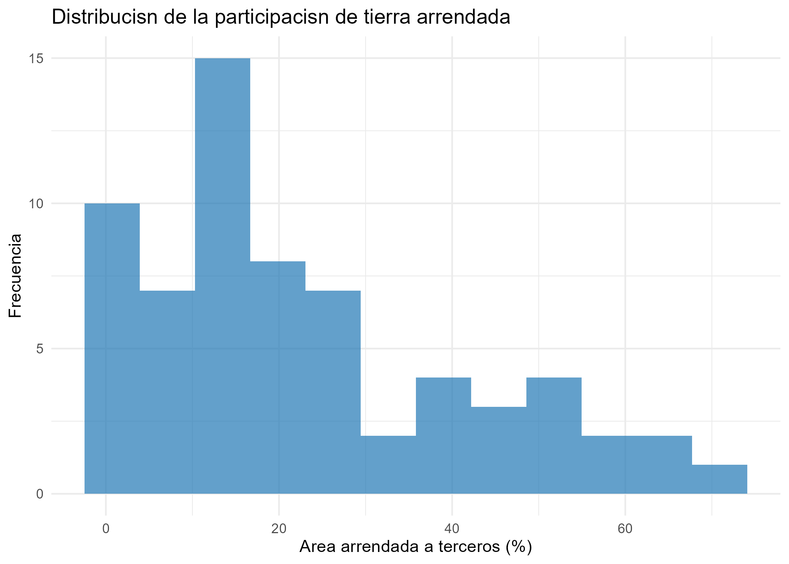
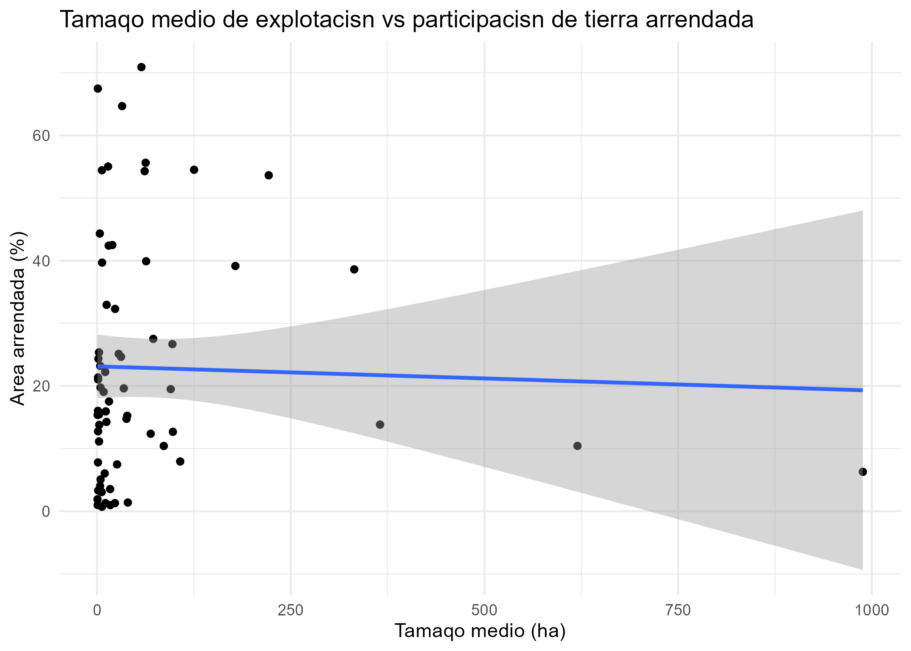
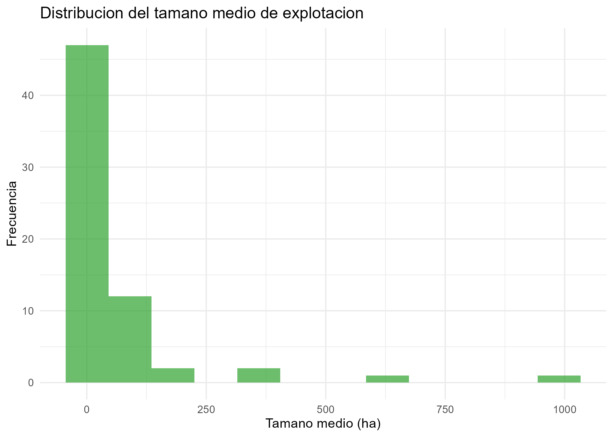
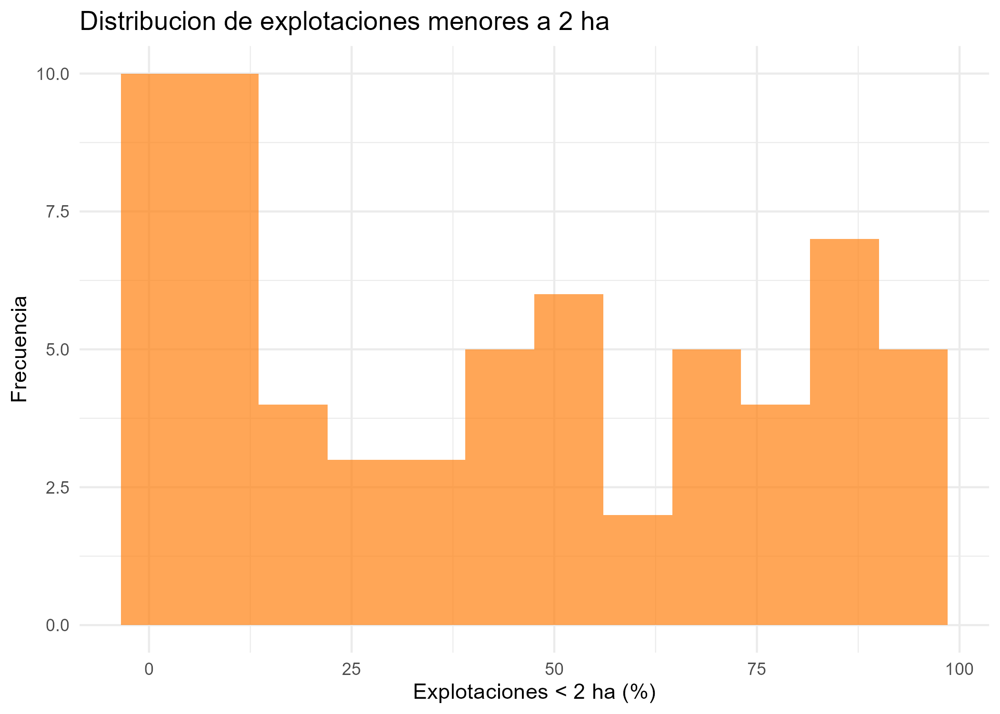
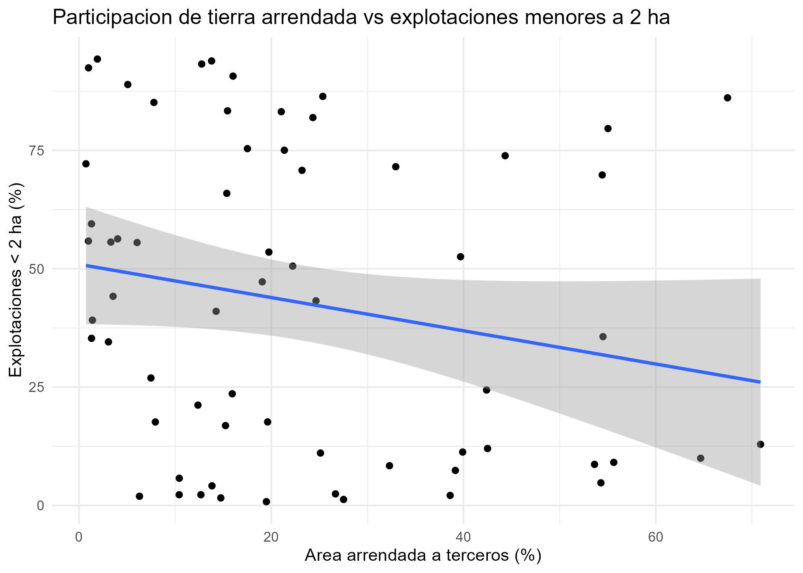
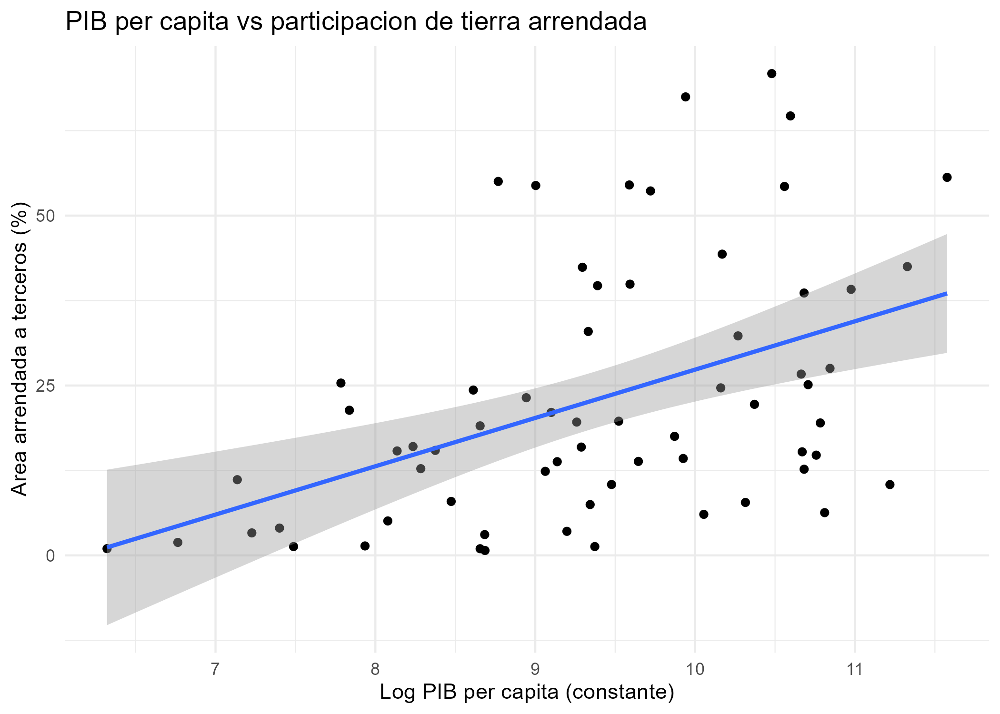
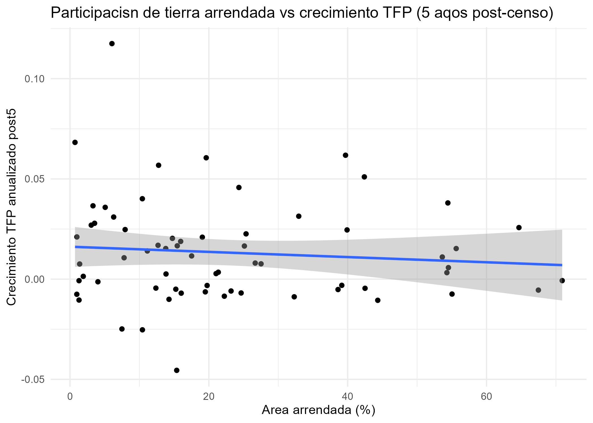
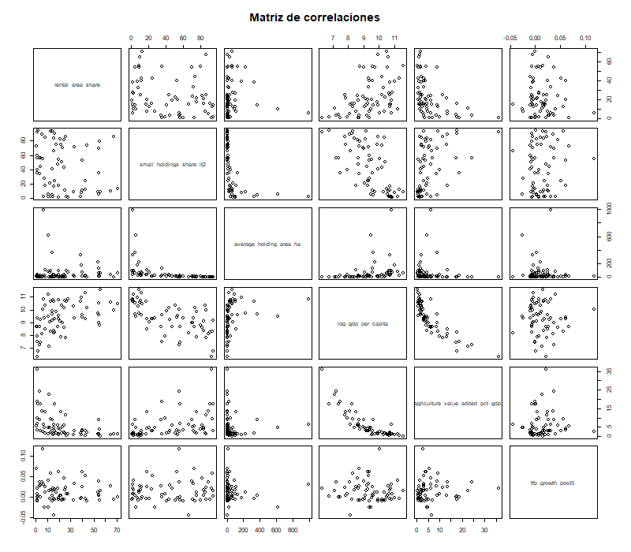
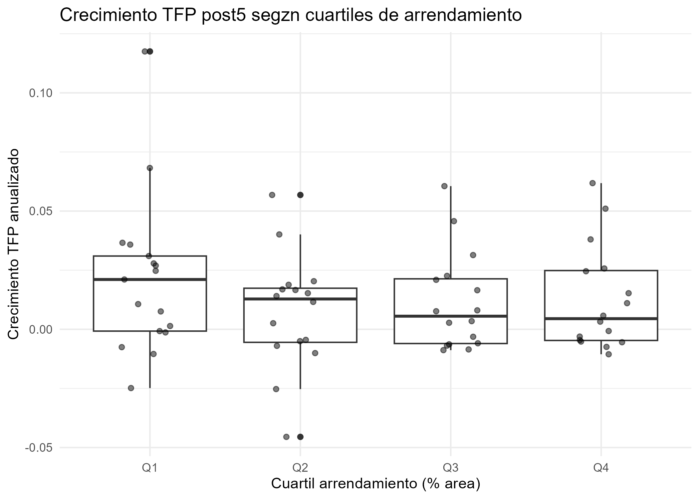

## 4.1 Estadística descriptiva

## 4.2 Distribución del arrendamiento y estructura agraria

## 4.3 Arrendamiento, estructura agraria y desarrollo

## 4.4 Relación entre arrendamiento y crecimiento de la TFP

## 4.5 Correlaciones

## 4.6 ANOVA por cuartiles de arrendamiento

## 4.7 Evidencia para el Objetivo 2

Con base exclusivamente en la base unificada (N=65), el modelo MCO muestra un coeficiente de `rental_area_share` pequeño e impreciso. Las correlaciones son bajas y el ANOVA por cuartiles no muestra diferencias marcadas entre grupos, lo que indica una asociación débil entre la prevalencia del arrendamiento y el crecimiento posterior de la TFP agrícola.
