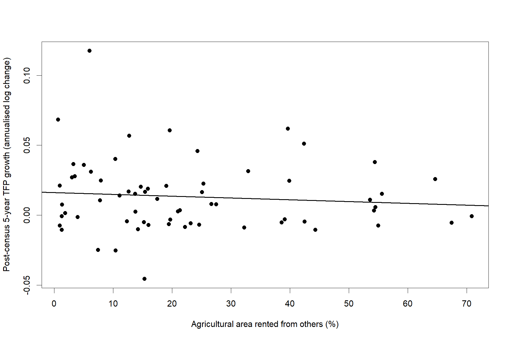
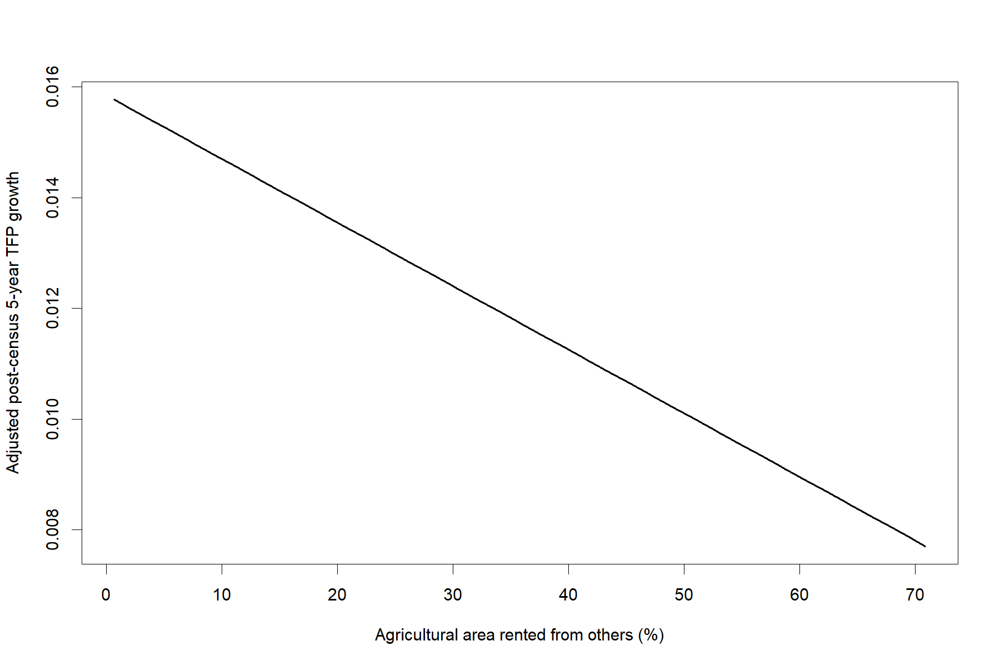

# 1. Introduction

Agricultural productivity differences reflect not only technology and input accumulation but also how effectively land, labor, capital, and managerial ability are allocated across producers. Cross-country development accounting and quantitative work repeatedly identify agriculture as an important source of aggregate productivity gaps, while farm-level evidence shows that weak factor allocation can coexist with large dispersion in marginal products [@restuccia2008agriculture; @lagakoswaugh2013selection; @adamopoulos2014size; @chen2023misallocation; @bolhuis2026misallocation]. Land is central to this problem because it is spatially fixed, institutionally regulated, and often distributed through historical or administrative arrangements rather than current productive advantage. Where land cannot move readily between operators, productive farmers may remain land-constrained while less productive operators retain land, creating scope for efficiency-enhancing reallocation.

Land rental is a potentially important adjustment mechanism because it separates ownership from operation without requiring a permanent transfer of the asset. Theoretical and empirical research on agrarian contracts emphasizes that tenancy can help equalize factor ratios across heterogeneous households, accommodate differences in farming ability and labor endowments, and facilitate occupational mobility [@otsuka1992contracts; @deiningerfeder2001institutions; @deininger2003land; @otsuka2007efficiency]. Evidence from China shows that rental markets can transfer land toward more productive users and support rural structural transformation [@deininger2005potential; @jin2009land; @deininger2014moving]. Evidence from India similarly indicates that restrictions on rural land rental can impede efficiency-enhancing transfers [@deininger2008restrictions], while recent experimental evidence from Kenya shows that lowering barriers to rental-market participation can increase land-market activity and alter operational land allocation [@acampora2025kenya].

The productivity consequences of rental markets are nevertheless conditional rather than mechanical. Participation reflects property rights, tenure security, contract enforcement, transaction costs, credit constraints, social relations, and opportunities outside agriculture. Classic evidence from Ghana and Niger demonstrates that perceived land rights and tenure arrangements can shape investment and allocation [@besley1995property; @gavian1996tenure; @goldsteinudry2008profits]. Related evidence from Burkina Faso, Pakistan, Ethiopia, Vietnam, Mexico, and China shows that contract design, duration, certification, security, and formalization may affect investment incentives, mobility, and productivity responses [@brasselle2002tenure; @bandiera2007contract; @jacobymansuri2008tenancy; @holden2009certification; @newman2015property; @dejanvry2015delinking; @li2021tenure; @ma2020renting]. A systematic review likewise finds that stronger tenure security can matter, but that effects vary with institutional setting and outcome definition [@higgins2018tenure]. Recent evidence in the rural-studies literature also shows that land certification can increase participation in rental markets and reshape factor allocation over time [@chen2025certification].

This institutional heterogeneity is crucial for interpreting rental prevalence. A high national share of rented land may reflect efficient reallocation, but it may also coexist with short contracts, weak enforcement, segmented markets, or transfers that do not systematically move land toward higher-productivity operators. Studies from Ethiopia, Malawi and Zambia, China, and Chile document both the allocative potential of rental markets and the importance of local frictions in determining who participates and who benefits [@deininger2013productivity; @holdenghebru2016restrictions; @chamberlin2016participation; @zhang2020rental; @sepulveda2025unlocking]. Evidence from Guatemala and India further demonstrates that distortions in land allocation can generate substantial aggregate productivity losses even when land markets exist [@britos2022distortions; @bolhuis2026misallocation]. Thus, the volume of rental activity and the effectiveness of the institutions governing that activity are analytically distinct.

Farm structure adds another layer of heterogeneity. Most farms worldwide are family operated and a large share are small, but the distribution of farm sizes varies sharply across development levels and regions [@lowder2016farms; @graeub2016family]. The long-standing debate over small-farm productivity, scale, and structural transformation shows why a simple measure of average farm size cannot by itself summarize allocative efficiency [@barrett2010inverse; @wiggins2010small; @headeyjayne2014land]. Large-scale farming has expanded in some land-abundant settings, while smallholders remain central elsewhere, reflecting differences in technology, labor supervision, market access, institutions, and policy [@deiningerbyerlee2012large]. Measurement also matters: errors in reported farm area can materially affect estimated size-productivity relationships [@carletto2013measurement].

Against this background, this article asks a deliberately narrower aggregate question: does greater national prevalence of agricultural rental arrangements predict faster subsequent national agricultural TFP growth? The analysis links internationally harmonized agricultural-census indicators to subsequent productivity dynamics and treats rental prevalence as an observable market-participation statistic rather than a direct measure of institutional quality. The contribution is threefold. First, it provides a cross-country boundary test of whether the reallocative mechanism documented in microeconomic studies is visible in aggregate productivity growth. Second, it separates rental-market prevalence from rental-market effectiveness, avoiding the assumption that a larger transaction share necessarily implies more efficient allocation. Third, it evaluates the association using a reproducible design with predefined robustness checks and conservative inference. The resulting evidence is intentionally associational: it can inform the interpretation of aggregate rental indicators, but it cannot identify the causal effect of rental-market reforms. Framed in rural-studies terms, the paper evaluates whether a readily observable feature of rural land institutions—rental prevalence—contains information about subsequent structural productivity dynamics beyond what can be learned from farm-level transactions alone.

# 2. Conceptual framework

The conceptual mechanism is straightforward: land rental can affect agricultural productivity through reallocation, but every link in that chain is institutionally mediated. Rental makes it possible to separate land ownership from operational control, which can move land toward households with greater farming ability, more labor, stronger complementary assets, or better access to technology [@deiningerfeder2001institutions; @otsuka2007efficiency]. In frictionless settings, such transfers should narrow differences in marginal returns across farms. In practice, imperfect labor, credit, insurance, and land markets can prevent that equalization [@dillonbarrett2017factor; @chen2022effects].

**Land rental → land reallocation → operational scale and input allocation → agricultural productivity.**

The first link depends on participation and selection into the market. Households may rent out when labor shifts toward nonfarm activities, and productive but land-poor operators may rent in to expand cultivated area. Evidence from China and Sub-Saharan Africa supports these adjustment channels, while also showing that wealth, labor endowments, transaction costs, and policy restrictions shape participation [@jin2009land; @chamberlin2016participation; @deininger2017smallholders]. Rental restrictions can therefore suppress mutually beneficial transactions, whereas better access can increase the scope for reallocation [@deininger2008restrictions; @acampora2025kenya]. Distributional effects also need not be uniform: land markets can alter both efficiency and access across heterogeneous households [@baland2007distributive].

The second link depends on the direction and quality of reallocation. Productivity gains require land to move toward uses with higher marginal returns, not merely to change contractual status. Microeconomic evidence shows that land-market frictions and misallocation can have quantitatively important effects on output and productivity [@chen2022effects; @chen2023misallocation; @britos2022distortions; @sepulveda2025unlocking]. Contractual institutions also matter after transfer. Short or insecure agreements can weaken incentives for non-contractible or long-horizon investments, while stronger rights or certification may improve investment incentives under some conditions [@bandiera2007contract; @jacobymansuri2008tenancy; @holden2009certification; @li2021tenure]. The empirical literature therefore does not justify treating every rented hectare as an equally effective unit of reallocation.

Farm structure may condition these mechanisms. Where very small holdings are widespread, rental could in principle consolidate operational area and relax scale constraints, but small-farm prevalence can also proxy for demographic pressure, missing factor markets, agroecological conditions, or measurement differences [@lowder2016farms; @headeyjayne2014land; @barrett2010inverse]. Conversely, larger average holdings do not necessarily imply better allocation because scale distributions may reflect policy, land abundance, mechanization, or historical concentration [@deiningerbyerlee2012large; @adamopoulos2014size]. For this reason, the interaction between rental prevalence and the share of holdings below two hectares is treated as a test of structural heterogeneity rather than as evidence of a causal mechanism.

Aggregation imposes an additional identification limit. National TFP growth reflects technological change, input quality, infrastructure, climate shocks, commodity-market conditions, structural transformation, and policy, in addition to land reallocation. Cross-country productivity differences also reflect selection and broader development processes [@restuccia2008agriculture; @lagakoswaugh2013selection]. Consequently, an aggregate rental share is a coarse proxy for a multidimensional institutional process. The empirical question is therefore whether that observable prevalence measure contains a stable predictive signal for subsequent TFP growth after parsimonious conditioning, not whether well-functioning rental markets can raise productivity.

# 3. Data and empirical strategy

The core structural source is the Food and Agriculture Organization of the United Nations structural data from agricultural censuses, released through the World Census of Agriculture statistical domain [@fao2026wcad]. Agricultural censuses provide national snapshots of holding size, tenure arrangements, land use, labor, and other structural characteristics. The analysis uses the harmonized share of agricultural area rented from others as the preferred rental exposure and selected indicators of farm structure. International census harmonization remains imperfect because national definitions, reference periods, and coverage can differ, a general concern in cross-country work on farm structure [@lowder2016farms]. The reproducible pipeline therefore includes explicit audits of variable classification, country-year comparability, and cross-source overlap before estimation.

Agricultural productivity dynamics are measured with the U.S. Department of Agriculture Economic Research Service International Agricultural Productivity data product [@usda2026iap]. The database provides annual agricultural TFP indices constructed with internationally harmonized output and input concepts. Because each country's index is normalized to a common base year, the data are appropriate for comparing productivity growth rates over time, not cross-country productivity levels. The outcome is therefore an annualized log change in TFP after the census rather than a difference in index levels across countries.

Development controls come from the World Bank World Development Indicators [@worldbank2026wdi]. The baseline covariates are log GDP per capita and agriculture value added as a share of GDP. These variables parsimoniously capture broad development conditions and the relative economic importance of agriculture without expanding the specification into a large set of researcher-selected controls. Average holding area, entered in logarithms, provides a direct census-based measure of farm structure. This choice also limits sensitivity to the highly skewed international distribution of farm size, while recognizing that land-area measurement can itself be consequential for agricultural inference [@carletto2013measurement].

The analytical design links census-year structural measures to annual TFP observations. The baseline outcome is the annualized log change in agricultural TFP over the five years following the census. The preferred exposure is the percentage of agricultural area rented from others. The final baseline sample contains 65 countries with complete information for the approved specification. Because sample membership is determined by overlap among usable census rental indicators, USDA productivity series, and development controls, the sample is not a random draw from the population of countries and should not be interpreted as design-based globally representative.

The empirical strategy is deliberately parsimonious and was specified before interpreting robustness results. The baseline model relates five-year post-census TFP growth to rental-area share, log average holding area, log GDP per capita, and agriculture value added as a share of GDP. Inference uses HC3 heteroskedasticity-consistent standard errors. Robust covariance estimators address unknown forms of heteroskedasticity [@white1980hc], and HC3 has favorable finite-sample properties relative to simpler heteroskedasticity-consistent estimators, particularly in modest samples [@mackinnon1985hc; @longervin2000hc]. The analysis reports associations rather than causal effects because rental prevalence is not randomly assigned and can reflect institutions, historical land systems, market development, and other partially observed conditions.

A predefined interaction model evaluates whether the rental association varies with the national share of agricultural holdings below two hectares. Rental-area share and the small-holding share are mean-centered before constructing the interaction so that their main effects remain interpretable near the sample means. The interaction is treated as a structural heterogeneity test, not as a causal estimate of how fragmentation modifies a rental-market treatment.

The robustness design addresses distinct threats rather than searching over specifications for significance. A three-year post-census outcome tests sensitivity to the horizon; five-year pre-census TFP growth serves as a diagnostic for pre-existing productivity dynamics; observations flagged by Cook's distance are excluded in an influence check; the share of holdings rented from others replaces rental-area share as an alternative exposure; and post-minus-pre TFP growth provides an acceleration outcome. Finally, an exploratory repeated-census country fixed-effects specification uses within-country variation where multiple usable censuses are available. Because that panel is substantially smaller, it is interpreted as complementary evidence rather than a preferred estimator.

# 4. Results





*Note:* TFP growth is an annualized log change. Rental-area share and agriculture value added are expressed in percentage points.



*Note:* The structural interaction specification centers the rental-area share and the share of holdings below two hectares before constructing the interaction term. Estimates are associational rather than causal.



*Note:* "Effect per 10 pp" rescales the estimated rental coefficient to a ten-percentage-point difference in the corresponding rental measure. The country fixed-effects model is exploratory because of its smaller repeated-census sample.

{#fig-rental-tfp width=85%}

{#fig-adjusted-rental-tfp width=85%}

# 5. Discussion and implications for rural policy

The central finding—a small and imprecisely estimated aggregate association—is best interpreted as a boundary condition on what rental prevalence can reveal, not as a rejection of the reallocative mechanism emphasized in the land-market literature. Farm- and household-level studies repeatedly show that rental can transfer operational land toward more productive or land-poor operators, support occupational adjustment, and improve resource allocation under favorable conditions [@deininger2005potential; @jin2009land; @deininger2013productivity; @chamberlin2016participation; @chen2022effects; @acampora2025kenya]. Recent evidence from Chile likewise finds that rental-market access costs can generate productivity losses through misallocation [@sepulveda2025unlocking]. The present cross-country result addresses a different question: whether a larger national rental share, without direct information on those institutional conditions, predicts faster aggregate TFP growth. This distinction is especially relevant for rural studies because land rental is simultaneously an economic transaction, a tenure institution, and a mechanism through which rural households adjust operational scale, labor allocation, and livelihood strategies.

A first explanation for the weak aggregate signal is that transaction prevalence is not equivalent to market quality. Countries with similar rental shares can differ in contract duration, enforcement, registration, bargaining power, transaction costs, credit access, and legal restrictions. These features affect both participation and post-transfer incentives [@bandiera2007contract; @jacobymansuri2008tenancy; @holdenghebru2016restrictions; @li2021tenure; @ma2020renting]. Recent evidence on long-run land certification likewise shows that stronger tenure arrangements can alter rental participation, operational farm size, investment patterns, and rural household welfare without producing uniform effects across outcomes [@chen2025certification]. More broadly, evidence on property rights and tenure security shows that institutional effects are context-dependent and can operate through investment, labor allocation, migration, and risk rather than through transaction volume alone [@besley1995property; @goldsteinudry2008profits; @dejanvry2015delinking; @higgins2018tenure; @schling2026regularization]. A prevalence indicator therefore captures how much rental occurs, but only indirectly whether those transactions are secure and allocatively productive.

A second explanation is aggregation. Even economically meaningful farm-level reallocations need not dominate national TFP growth, which combines technological change, input adjustment, infrastructure, climate exposure, price incentives, and structural transformation. Quantitative research shows that agricultural misallocation can be important for aggregate productivity, but its magnitude and sources differ across settings [@restuccia2008agriculture; @adamopoulos2014size; @chen2023misallocation; @britos2022distortions; @bolhuis2026misallocation]. If rental-market improvements benefit a subset of farms while other forces move national productivity in offsetting directions, the aggregate cross-country coefficient can remain close to zero even when micro-level gains are real.

A third explanation concerns farm structure and measurement. The insignificant interaction with the prevalence of holdings below two hectares does not imply that agrarian structure is irrelevant. Small farms differ in commercialization, labor intensity, market access, plot fragmentation, and technology, and national farm-size distributions differ sharply across regions [@wiggins2010small; @headeyjayne2014land; @lowder2016farms; @graeub2016family]. Moreover, reported area and holding definitions can affect measured size-productivity relationships [@barrett2010inverse; @carletto2013measurement]. A single small-holding share is therefore an intentionally coarse moderator. More informative cross-country tests would require harmonized measures of operated land concentration, parcel fragmentation, rental direction, contract characteristics, and productivity dispersion among potential landlords and tenants.

The robustness results strengthen a limited but useful inference: the main conclusion is not driven by one particular horizon, one rental metric, or a small set of influential cases. The near-zero repeated-census fixed-effects estimate also provides a directionally consistent check using within-country variation, although the 17-country panel is too small to support strong claims. This pattern argues against emphasizing any single p-value and instead supports a specification-stable interpretation of the evidence. It also illustrates why predefined diagnostics are preferable to specification searching when the available cross-country sample is modest.

Several limitations bound external and substantive interpretation. The 65-country baseline sample is generated by the intersection of usable census rental measures, USDA TFP series, and development controls, so it is neither random nor design-based globally representative. Agricultural censuses differ in reference year, national definitions, and the operational meaning of tenure categories despite harmonization. The country is also a highly aggregated unit: the data cannot identify which farms rent in or out, whether land moves toward higher-productivity operators, or whether contracts are written, enforceable, long-term, or secure. Finally, N = 65 provides limited precision for modest conditional associations, with substantially lower power in the interaction and repeated-census specifications.

These limitations clarify how the findings should be placed alongside the broader literature. Comparative household evidence from Malawi and Zambia finds common reallocative patterns but substantial contextual heterogeneity [@chamberlin2016participation], while multi-country evidence from Sub-Saharan Africa shows that land access and factor ratios respond to rental-market operation within diverse institutional environments [@deininger2017smallholders]. Studies of India and China demonstrate that policy restrictions and structural transformation can materially alter rental participation [@deininger2008restrictions; @deininger2014moving]. These studies identify mechanisms that a national prevalence statistic cannot distinguish. The aggregate analysis therefore complements rather than substitutes for microeconomic designs.

Future research should move from transaction prevalence toward multidimensional indicators of rental-market functioning. Priority measures include contract duration and enforceability, legal restrictions, transaction costs, registration, rental prices, direction of transfer, and the productivity characteristics of renters and landlords. The literature on tenure formalization and security suggests that institutional reforms can affect investment and resource use through several channels beyond rental participation [@holden2009certification; @newman2015property; @higgins2018tenure; @schling2026regularization]. Linking repeated agricultural censuses to such institutional measures—or exploiting policy changes that create plausibly exogenous variation in market access—would permit sharper tests of when rental markets improve aggregate productivity.

The rural-policy implication is correspondingly specific. Governments should not treat a rising rental share as a sufficient performance indicator for land-market reform or rural transformation. Policies that enable voluntary rental may still be valuable when they reduce transaction barriers, protect legitimate rights, and allow land to move toward more productive uses [@deiningerfeder2001institutions; @otsuka2007efficiency; @deininger2008restrictions]. But policy evaluation should focus on market functioning and allocative direction as well as transaction volume. Evidence that tenure regularization, market access, and contractual institutions can alter investment or efficiency reinforces the case for institution-sensitive indicators rather than prevalence targets alone [@holdenghebru2016restrictions; @li2021tenure; @sepulveda2025unlocking; @schling2026regularization].

# 6. Conclusion

This study tests whether countries with more prevalent agricultural land rental subsequently experience faster agricultural TFP growth. By linking harmonized FAO agricultural-census structure to USDA productivity dynamics and World Bank development indicators, the analysis extends the land-rental literature to an aggregate cross-country boundary test while preserving a clear distinction between transaction prevalence and institutional effectiveness.

The evidence does not reveal a stable relationship. In the 65-country baseline sample, a 10-percentage-point increase in rental-area share is associated with -0.0011 annualized post-census TFP growth (HC3 p = 0.598), and the interaction with the share of holdings below two hectares is also imprecise (p = 0.449). Alternative horizons, the pre-census diagnostic, exclusion of influential observations, the alternative rental measure, the growth-acceleration outcome, and the exploratory repeated-census fixed-effects model all preserve the same substantive interpretation.

This finding should not be read as evidence that rental markets fail to raise productivity. A substantial literature shows that rental transactions can improve access and reallocate land when market institutions allow productive operators to expand [@deininger2005potential; @jin2009land; @chen2022effects; @acampora2025kenya; @sepulveda2025unlocking]. The cross-country evidence instead indicates that prevalence alone is an insufficient summary of those mechanisms.

The practical implication for rural policy is to measure how rental markets work, not only how much land is rented. Comparative research and policy evaluation should pair census-based transaction shares with indicators of tenure security, contract enforceability, transaction costs, rental direction, and allocative outcomes. Such data would permit a more informative assessment of whether land-market institutions facilitate secure, low-cost transfers toward higher-productivity uses while avoiding causal claims that the current aggregate design cannot support.

# References
